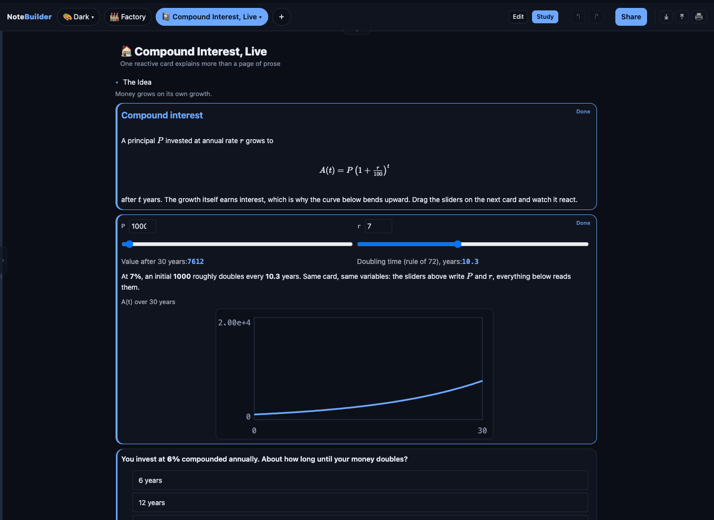
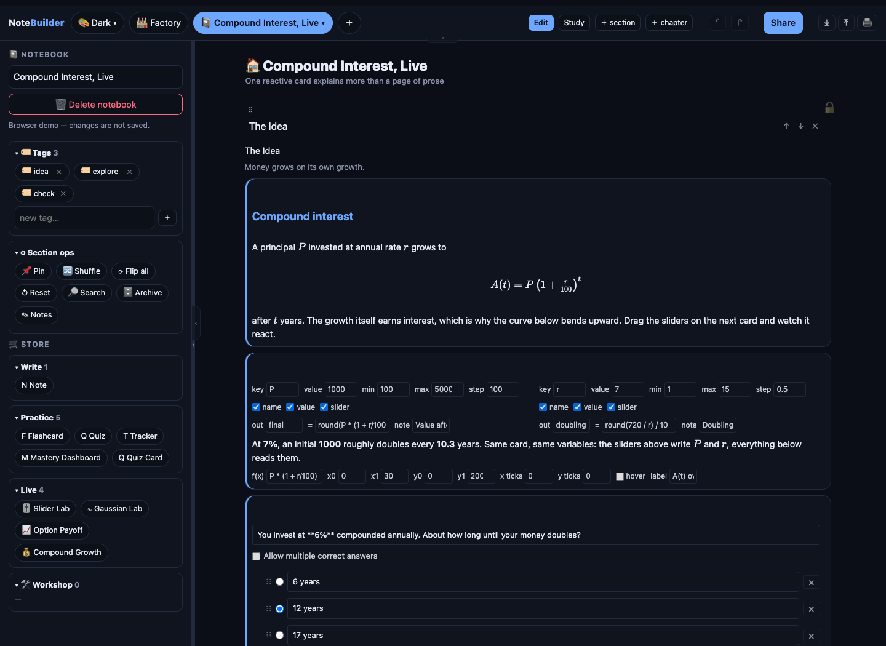
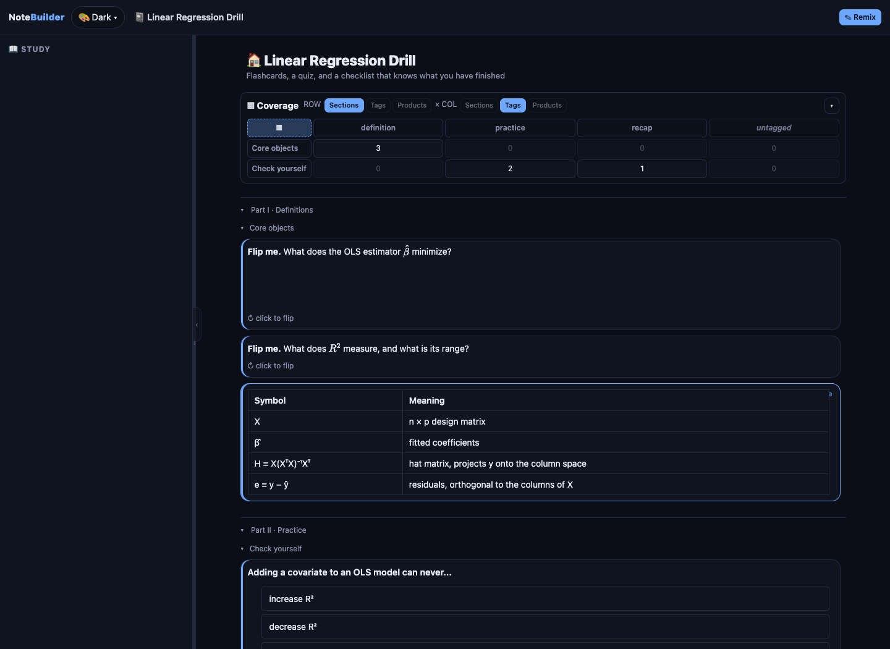
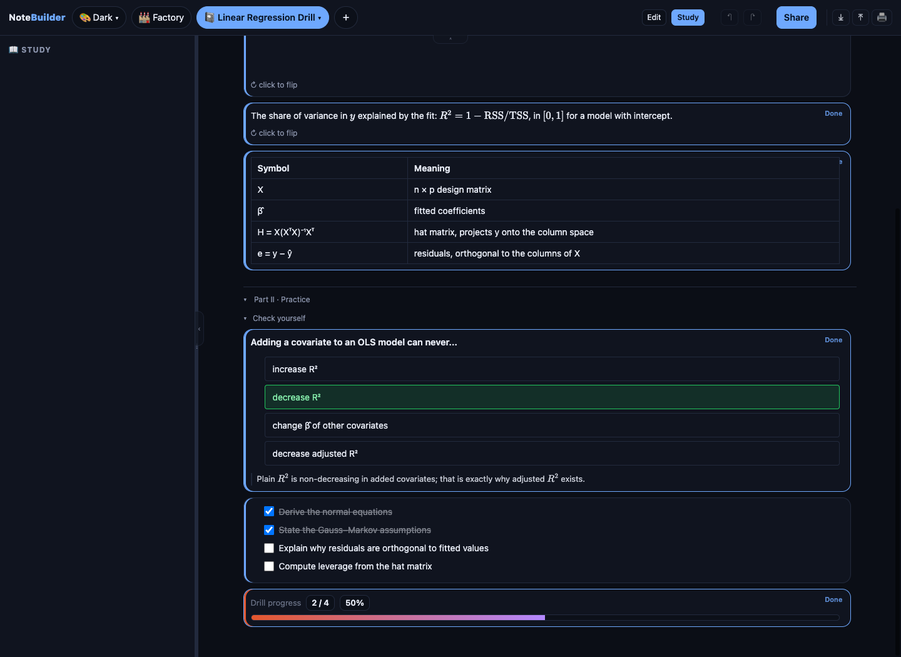
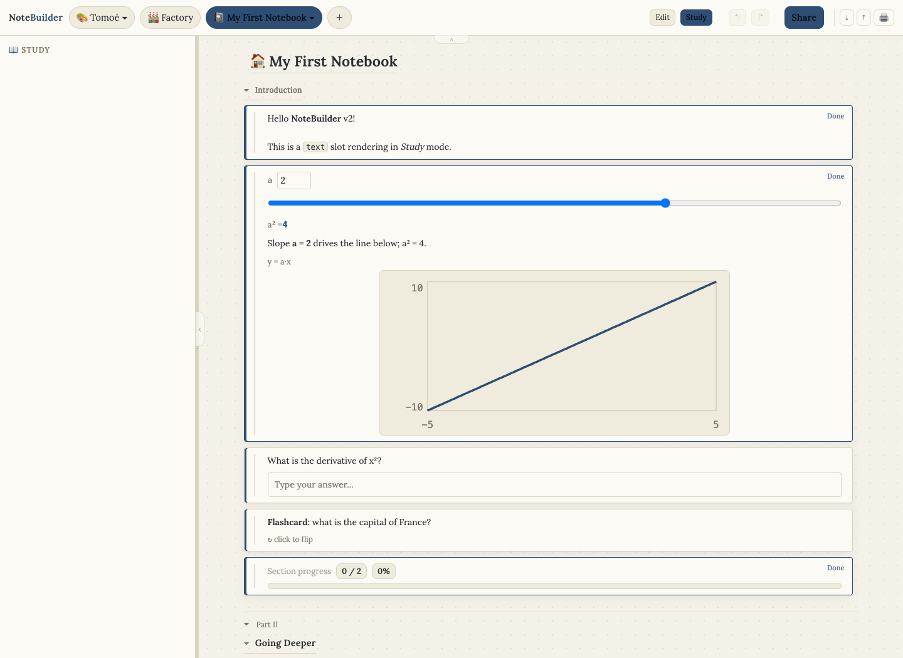
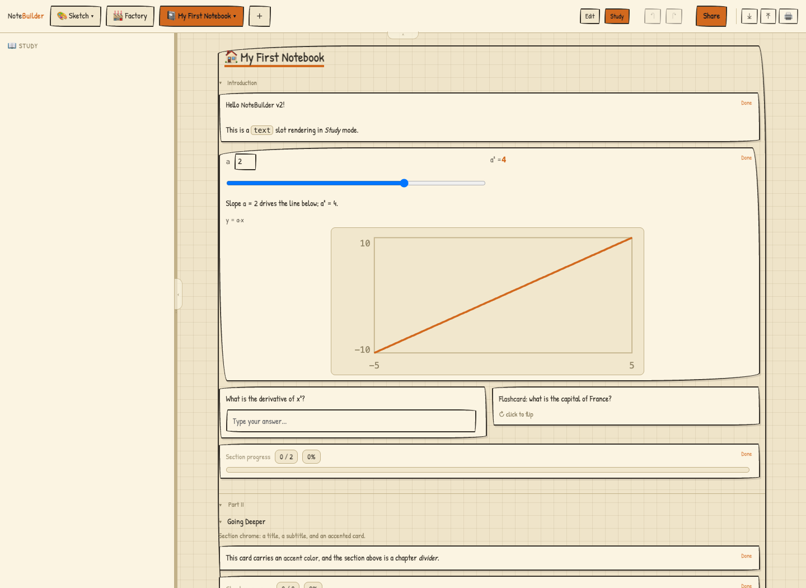
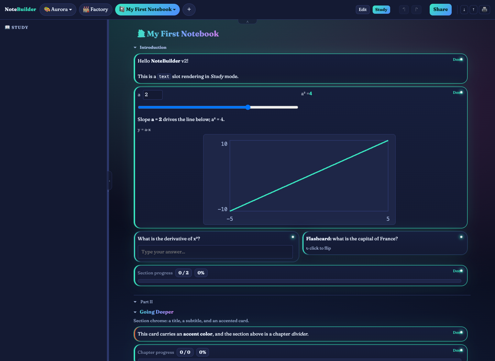
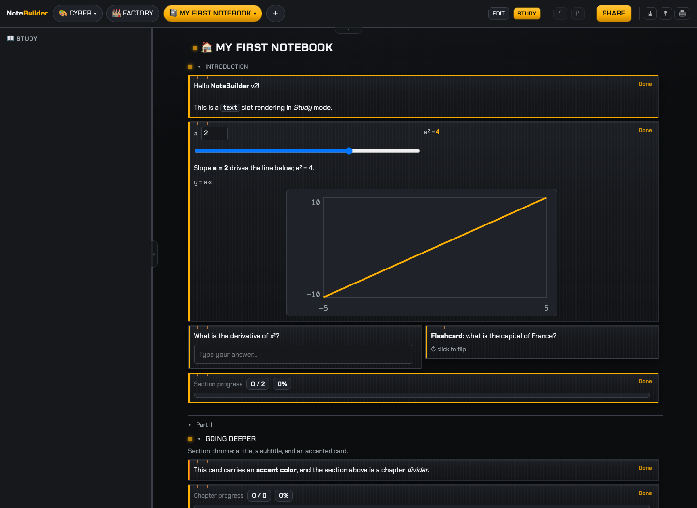

# NoteBuilder

[](https://github.com/YuZh98/notebuilder/actions/workflows/ci.yml)
[](v2/)
[](v2/package.json)
[](v2/src-tauri/)
[](v2/)
[](LICENSE)

**Study material that does something. Build notebooks from reactive cards, drill them in Study mode, and hand them to anyone as a single offline file.**

Drag a slider, and the formula, the prose, and the chart in that card recompute together; export the notebook and those same live cards keep running inside one offline `.html` file, where nothing the reader answers ever comes back to you.

NoteBuilder is a local-first macOS desktop app. Your notebooks live in a local SQLite database. No account, no cloud, no backend.



*The [`compound-interest`](docs/examples/compound-interest.json) example in Study mode: the two sliders write $P$ and $r$; the computed values, the prose, and the chart below all react as you drag. Import it yourself from [`docs/examples/`](docs/examples/).*

## Who is this for?

Anyone who makes study material and wants it to be more than frozen text:

- **Students and self-learners** who want flashcards that flip, quizzes that check themselves, practice problems with fresh numbers every attempt, and a progress meter that fills as *they* finish cards.
- **Teachers and tutors** who want to send one file that works in any browser, offline, with nothing to install on the other end, that remembers each student's progress and hands back a results summary.
- **Anyone explaining something quantitative.** A slider, a formula, and a chart in one card wire together and react live. Drag the slider, watch the curve move.

## Why not a document?

| Problem | Static notes | NoteBuilder |
| --- | --- | --- |
| Self-testing | Re-reading, highlighting | Flashcards flip, quizzes grade themselves, practice problems redraw their numbers, checklists tick |
| Quantitative intuition | A pasted screenshot of a plot | Slider drives formula drives chart, live, per card |
| Knowing where you stand | Gut feeling | Per-reader progress meters count what you have actually finished |
| Sharing | Recipient needs your app or an account | One self-contained `.html`, opens offline in any browser, remembers the reader's progress |
| Authoring cost | Hours per lesson | Any chat AI drafts it from the built-in prompt; you review the drafts |
| Coverage | Scroll and hope | Tag every card, read the coverage matrix |

## Quick start

Prerequisites: [Node 20+](https://nodejs.org), [Rust](https://rustup.rs), and Xcode Command Line Tools (`xcode-select --install`).

```bash
git clone https://github.com/YuZh98/notebuilder.git
cd notebuilder/v2
npm install
npm run tauri dev
```

That is the full desktop app, with SQLite persistence and native print. `npm run tauri build` produces an app bundle. For UI work without the native shell, `npm run dev` serves the app in a browser with a demo notebook (persistence no-ops there).

To package that build as a macOS disk image and install it like any other app, follow [`docs/install-macos.md`](docs/install-macos.md).

First thing to try: import [`grand-tour.json`](docs/examples/grand-tour.json) with the **⤒** button and hit **Study**. It is a rocket mission that puts every slot type to work in one notebook. For a short lesson built from the guided card types, import [`practice-lesson.json`](docs/examples/practice-lesson.json). The rest of the examples live in [`docs/examples/`](docs/examples/). Then **＋ → From AI…** to have your favourite chat AI draft a notebook on any topic.

## How it works

### Cards are built from slots

A card is a small stack of primitives arranged on a 12-column grid: text, slider, formula, chart, choice, practice problem, table, code, image, checklist, text answer, progress. Slots in the same card share variables and react to each other. Variables are strictly card-scoped; dependencies resolve by topological sort, and cycles or missing writers are caught at import. Nothing leaks across cards.

### Edit and Study are hard-separated

Edit shows structure and configuration. Study *is* the rendered, interactive result. `Cmd+Enter` flips between them. There is no half-live preview to fight with; Study mode is the preview.



*The same notebook in Edit mode: every slot becomes its configuration fields, and the sidebar holds tags, section operations, and the card-type store.*

### Have any AI draft it, then review

**＋ → From AI…** writes a complete prompt for ChatGPT, Claude, Gemini or any other chat AI: the format, every slot with an example, the formula grammar and the card-scope rule. Paste the reply back; NoteBuilder checks it (code fences and chatter are fine), lists any problems with where, what and how to fix, and gives you a fix request to paste back to the AI. Every card it creates is marked **draft** until you review it, and Share reminds you while drafts remain. No AI runs inside the app, and the format is published: [`docs/FORMAT.md`](docs/FORMAT.md).

### The Factory stamps card types

Design a slot arrangement once, seal it as a card type, then stamp independent copies into any notebook. Stamped cards are copies, not references, so editing a notebook never mutates your library. Built-ins include research-backed patterns: **Guided Explore** (predict, explore with sliders and a chart, then explain), **Worked Example** (steps with self-explanation, fading into practice) and **Practice Set**.

### Sharing is a file

Export a notebook as JSON for another NoteBuilder, or as a self-contained Reader `.html` that opens in any browser, offline. The recipient reads and interacts; their answers and progress are saved in their own browser and come back when they reopen the file. **My results** gives them a summary to copy or download for you. Nothing is sent anywhere. A shared file carries only that notebook, never the rest of your library.

### The two ends of a notebook

|  |  |
| --- | --- |
| *Edit mode: every slot becomes its configuration fields, and the sidebar holds tags, section operations, and the card-type store.* | *The shared `.html` in a plain browser: authoring chrome is gone, a single **Remix** unlocks editing, and the quiz is unanswered because the reader's state is their own.* |

### And the comforts

Full undo/redo, version history with restore, saves that survive a crash or a Cmd+Q, drag-and-drop everything (cards, slots, tags, services), tags with a coverage matrix, themes, GFM markdown with `$KaTeX$` math, native print. A whole Study session runs from the keyboard (`j`/`k` to move, space to flip, `1`-`9` to answer, `x` to tick), in the app and in a shared file alike, with `?` listing every shortcut.



*The [`regression-drill`](docs/examples/regression-drill.json) example mid-study: the quiz has been answered and explains itself, two checklist items are done, and the notebook-wide progress meter sits at 2/4.*

### Eight themes, one picker

Every screenshot above uses the default dark theme. Seven more ship with the app, switched from the palette button in the top bar; here are four of them on the same demo notebook.

|  |  |
| --- | --- |
| *Tomoé: stationery. Cream paper, serif headings, ruled margins on every card.* | *Sketch: graph paper, wobbly ink frames, marker lettering.* |
|  |  |
| *Aurora: fantasy night sky, cards that glow at the edges.* | *Cyberpunk: amber wireframes and uppercase everything.* |

## Where your data lives

One SQLite file in your own account, written by the app itself:

```text
~/Library/Application Support/com.notebuilder.app/
└── notebuilder.db     notebooks, card types, tags, reader state, preferences
```

SQLite keeps its own `notebuilder.db-wal` and `notebuilder.db-shm` companion files next to it, so the folder shows three names for one database. Delete the database and NoteBuilder starts empty. Everything else NoteBuilder writes is a file you asked it to export, saved where you pointed the dialog. Run `npm run dev` in a browser instead of the desktop app and there is no database at all; the demo notebook lives only in memory.

## Built to last

2718 tests across 204 files, TypeScript strict, svelte-check clean, CI on every push. Invariants are enforced by tests, not convention.

The long-form guides:

- [Architecture](docs/architecture.md): the v2 layer split, where your data lives at runtime, and the two build targets.
- [UI design system](docs/ui-design-system.md): the `app.css` design tokens, theming, and the rule that keeps them authoritative.
- [Notebook format](docs/FORMAT.md): the version 2 notebook JSON, slot by slot, its published JSON Schema, and the rules an AI author must follow.

<details>
<summary><strong>Engineering deep-dive</strong></summary>

### Architecture

```text
v2/src/lib/slots/      slot primitives: one Edit + one Study component per slot, one contract
v2/src/lib/drag/       a single pointer-based drag engine for notebook and study surfaces; the Factory inventory chips still use native HTML5 drag
v2/src/lib/            variable graph, history, tags, import/export, themes, markdown
v2/src-tauri/          Rust shell: SQLite (migrations in lib.rs), native print, dialogs
```

- **State layers.** Document state persists and exports; reader state (answers, ticks, progress) persists locally and never exports; session state is transient. The separation is what makes a shared file safe to open.
- **Migrations always.** A persisted-shape change ships a SQLite migration; an interchange change bumps the JSON schema version and ships an import migration. Old files keep loading.
- **Atomic, serialized saves.** Every database access rides one queue; each save is a single transaction batch; nothing is written before startup loading succeeds; the real SQL and every migration are tested against SQLite.
- **Security posture.** No `eval` on user content; formulas run through a small own-keys-only expression evaluator. All user text is escaped before markdown or KaTeX markup is applied. Parameterized SQL throughout. See [SECURITY.md](SECURITY.md).
- **Guard tests.** Source-level sweep tests lock invariants: no props mutation in Edit components, no native drag outside the Factory inventory chips, Reader/App prop parity. Regressions fail loudly.

Architecture map: [`docs/CODE-MAP.md`](docs/CODE-MAP.md). Notebook format: [`docs/FORMAT.md`](docs/FORMAT.md). Contributing: [`CONTRIBUTING.md`](CONTRIBUTING.md).

</details>

## The original prototype

The repository root holds the first NoteBuilder: a single-file web app (vanilla JS, localStorage, the whole product in one `index.html`) that proved the slot/card model and the one-file sharing story. Its Playwright suite still gates CI whenever the root app changes, but it is legacy. New work happens in [`v2/`](v2/).

## License

[MIT](LICENSE).
