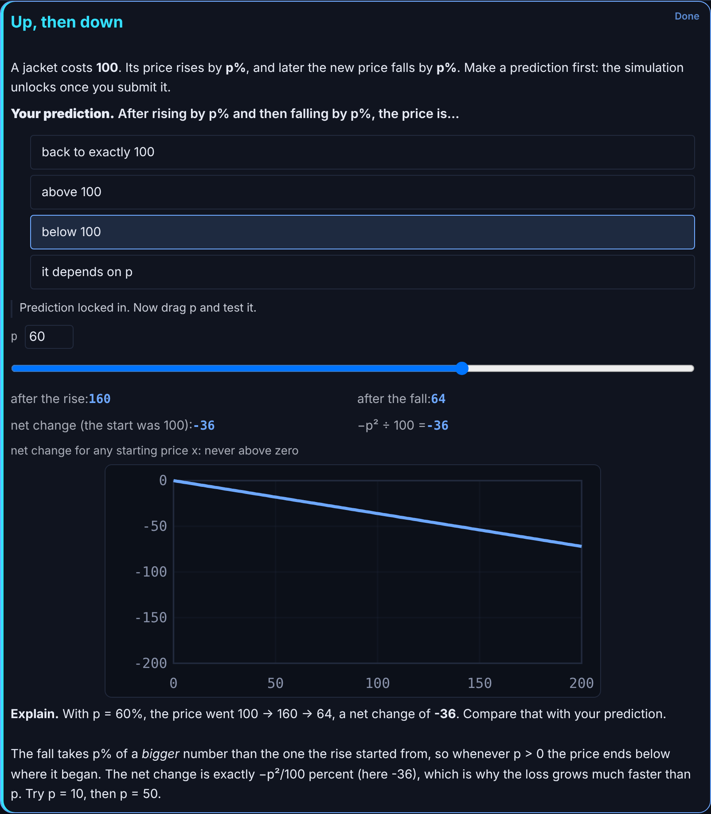
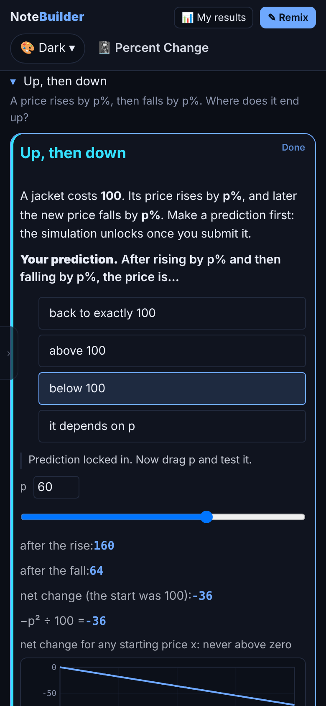
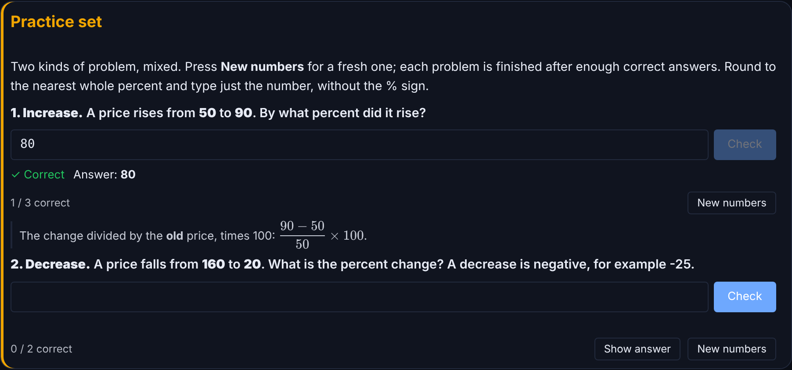
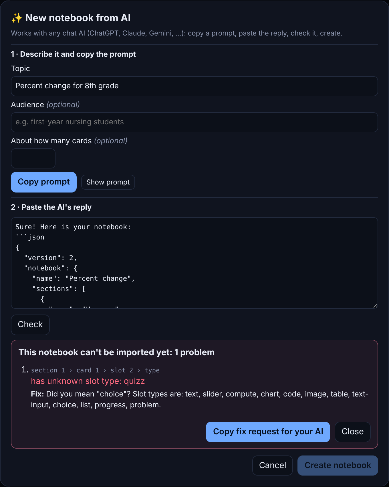
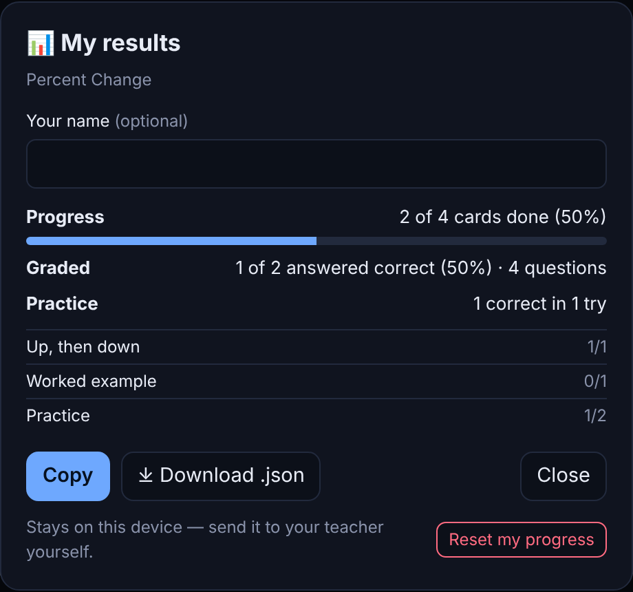
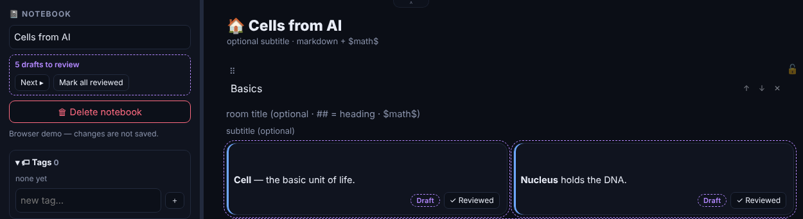

<div align="center">

# NoteBuilder

**Local-first interactive study notebooks for macOS.**<br>
Build lessons from live cards (sliders, formulas, charts, quizzes and practice problems), then share them as one offline file that remembers each reader's progress.

[](https://github.com/YuZh98/notebuilder/releases/latest)
[](https://github.com/YuZh98/notebuilder/releases/latest)
[](https://yuzh98.github.io/notebuilder/demo/percent-change.html)
[](docs/install-macos.md)
[](https://github.com/YuZh98/notebuilder/actions/workflows/ci.yml)
[](v2/)
[](LICENSE)

**[Website](https://yuzh98.github.io/notebuilder/)** · **[Try a lesson, no install](https://yuzh98.github.io/notebuilder/demo/percent-change.html)** · **[Download for macOS](https://github.com/YuZh98/notebuilder/releases/latest)** · [What's new](CHANGELOG.md)

<br>


</div>

---

NoteBuilder is a desktop app for making study material that does something. Drag a slider and the formula, the sentence and the chart in that card recompute together. Export the notebook and those same live cards keep running inside one `.html` file that opens offline in any browser, on any device, with nothing to install. Your notebooks stay in a local database on your Mac: no account, no cloud, no backend.

The current release is **0.3.0**, "the living handout": shared files remember progress, practice problems draw fresh numbers, any chat AI can draft a lesson, and saves are atomic with version history. See the [changelog](CHANGELOG.md).

## Features

- **Live cards.** A card is a small stack of slots: text with math, slider, formula, chart, quiz, practice problem, checklist, table, code, image, written answer and progress. Slots in one card share variables, so a slider drives a formula, the formula drives a chart, and the text quotes the result.
- **Fresh-number practice.** Write a problem once with ranges and a formula; every attempt draws new numbers and checks the typed answer. Each reader gets their own sequence, and an answer they peeked at earns no credit.
- **Research-backed card types.** Guided Explore (predict, explore, explain), Worked Example (steps with self-explanation, fading into practice) and Practice Set are built in. Design your own in the Factory and stamp copies into any notebook.
- **Share one offline file.** The shared `.html` works in any browser on a phone or laptop, saves each reader's answers and progress in their browser, and loads nothing from the internet itself, fonts included; only images you link by URL are fetched.
- **Results for the teacher.** Readers open **My results** to copy or download a summary of their progress and graded answers, and send it to you. Nothing is sent automatically.
- **Draft with any AI, review before sharing.** **＋ → From AI…** writes a complete prompt for ChatGPT, Claude, Gemini or any chat AI. Paste the reply back and NoteBuilder checks it, says exactly what to fix, and imports every card as a draft for you to review.
- **Saves you can trust.** Every save is one atomic SQLite transaction, flushed when you switch away, close the window or quit. Versions are kept automatically, and a restore can be undone.
- **Keyboard-first Study.** `j`/`k` to move, space to flip, `1`-`9` to answer, `x` to tick, `?` for every shortcut, in the app and in a shared file alike.
- **An open format.** Notebooks export as plain JSON with a published [JSON Schema](v2/src/lib/schema/notebook.schema.json) and [format guide](docs/FORMAT.md), so your lessons outlive the app.
- **Comforts.** Full undo/redo, drag-and-drop for cards, slots and tags, a tag coverage matrix, eight themes, zoom and native print.

## Screenshots

<table>
<tr>
<td></td>
<td align="center"></td>
</tr>
<tr>
<td><em>Guided Explore: predict first, then the slider, numbers and chart unlock</em></td>
<td><em>The same shared file on a phone, offline</em></td>
</tr>
<tr>
<td colspan="2"></td>
</tr>
<tr>
<td colspan="2"><em>Practice set: fresh numbers every attempt, an instant check, and the worked explanation after a correct answer</em></td>
</tr>
<tr>
<td></td>
<td></td>
</tr>
<tr>
<td><em>From AI: paste the reply, get precise fixes to send back</em></td>
<td><em>My results: a summary students send back to you</em></td>
</tr>
<tr>
<td colspan="2"></td>
</tr>
<tr>
<td colspan="2"><em>AI-made cards arrive as drafts you review one by one; Share reminds you while any remain</em></td>
</tr>
</table>

<details>
<summary><strong>More screenshots: Edit mode, a shared file on the desktop, and themes</strong></summary>

<br>

|  |  |
| --- | --- |
| *Edit mode: every slot becomes its configuration fields. `Cmd+Enter` flips to Study.* | *A shared file on the desktop: the authoring chrome is gone and **Remix** unlocks editing.* |
|  |  |
| *Tomoé: stationery, serif headings, ruled margins.* | *Sketch: graph paper, wobbly ink frames.* |
|  |  |
| *Aurora: night sky, cards that glow at the edges.* | *Cyberpunk: amber wireframes, uppercase everything.* |

</details>

## Who it's for

- **Teachers and tutors** who want to send one file that works in any browser, offline, with nothing to install on the other end, that remembers each student's progress and hands back a results summary.
- **Students and self-learners** who want flashcards that flip, quizzes that check themselves, practice with fresh numbers every attempt, and a progress meter that fills as they finish cards.
- **Anyone explaining something quantitative.** A slider, a formula and a chart wired together in one card say more than a page of prose.

## Install

**[Download the latest DMG](https://github.com/YuZh98/notebuilder/releases/latest)** (Apple silicon Macs, macOS 11 or newer)

1. Open the DMG and drag **NoteBuilder** to **Applications**.
2. NoteBuilder isn't notarized yet, so the first launch takes one extra step:
   - **macOS 15 Sequoia or later:** open the app, click **Done**, then go to System Settings → Privacy & Security and click **Open Anyway**.
   - **macOS 14 or earlier:** right-click the app and choose **Open**.
3. If macOS says the app "is damaged", run `xattr -dr com.apple.quarantine /Applications/notebuilder.app` and open it again.

Details, and why there is no Intel build yet: [docs/install-macos.md](docs/install-macos.md).

**No Mac?** A shared lesson needs no install at all. [Open one in your browser](https://yuzh98.github.io/notebuilder/demo/percent-change.html), answer something, reload, and your progress is still there.

## Build from source

**Requirements:** macOS, [Node 20+](https://nodejs.org) (22 to run every test), [Rust](https://rustup.rs) and Xcode Command Line Tools (`xcode-select --install`).

```bash
git clone https://github.com/YuZh98/notebuilder.git
cd notebuilder/v2
npm install
npm run tauri dev      # the desktop app, with SQLite persistence and native print
```

```bash
npm run tauri build    # app bundle and styled DMG under src-tauri/target/release/bundle/
npm run dev            # the UI in a browser with a demo notebook (nothing is saved)
npm test               # 2718 tests; npm run check for TypeScript, npm run build for the bundle
```

First thing to try: import [`grand-tour.json`](docs/examples/grand-tour.json) with the **⤒** button and press **Study**. It is a rocket mission that puts all twelve slot types to work. For a short lesson built from the guided card types, import [`practice-lesson.json`](docs/examples/practice-lesson.json). More in [`docs/examples/`](docs/examples/).

Your data lives in one SQLite database in your own account:

```text
~/Library/Application Support/com.notebuilder.app/
└── notebuilder.db     notebooks, card types, tags, reader state, version history, preferences
```

SQLite keeps `notebuilder.db-wal` and `notebuilder.db-shm` next to it. Everything else NoteBuilder writes is a file you asked it to export.

## How it works

- **Cards are built from slots.** Slots sit on a 12-column grid inside a card and share that card's variables. Variables never cross cards; dependencies resolve by topological sort, and cycles or missing values are caught at import.
- **Edit and Study are separate.** Edit shows structure and configuration; Study *is* the live, interactive result. `Cmd+Enter` flips between them.
- **The Factory stamps card types.** Design a slot arrangement once, seal it as a card type, and stamp independent copies into any notebook. Editing a notebook never changes your library.
- **Sharing is a file.** Export JSON for another NoteBuilder, or a self-contained Reader `.html` for anyone. A shared file carries only that notebook, and readers' answers stay in their own browser.

## Status and roadmap

NoteBuilder is in active development. 0.3.0 is the current release, and every change to the app runs the full test suite in CI.

**Next, roughly in order** (plans, not promises):

- a spaced-repetition review queue, so flashcards and problems come back when they are due;
- import from Anki and CSV;
- a notarized build, so the first launch needs no extra step.

**Not planned:** accounts, a cloud service, telemetry, or anything else that sends your notes off your machine.

Ideas and bug reports are welcome in [issues](https://github.com/YuZh98/notebuilder/issues).

## Architecture

```text
v2/                        the app (Svelte 5 + TypeScript + Tauri 2)
├── src/App.svelte         the desktop app shell
├── src/reader-main.ts     entry point of the shared Reader file
├── src/lib/slots/         one Edit and one Study component per slot type, one contract
├── src/lib/components/    notebook, Factory, Reader, From AI, results and version panels
├── src/lib/drag/          the single pointer-based drag engine
├── src/lib/schema/        the published notebook JSON Schema
├── src/lib/generated/     the committed Reader template (CI fails if it is stale)
└── src-tauri/             Rust shell: SQLite and its migrations, native print, dialogs
site/                      the website and the script that builds its demo lessons
docs/                      architecture, format, design system, install guide, examples
index.html, src/, tests/   the original single-file prototype (legacy)
```

Key design decisions:

- **Three state layers.** Document state persists and exports; reader state (answers, ticks, progress) persists locally and never exports; session state is transient. That separation is what makes a shared file safe to open.
- **Atomic, serialized saves.** Every database access rides one queue, each save is one transaction, nothing is written before startup loading succeeds, and the real SQL and every migration are tested against SQLite.
- **Migrations always.** A change to stored data ships a SQLite migration; a change to the notebook format bumps its version and ships an import migration. Old files keep loading.
- **Untrusted content is handled as untrusted.** No `eval`: formulas run through a small expression evaluator. User text is escaped before markdown or math markup is applied, and SQL is parameterized. See [SECURITY.md](SECURITY.md).
- **Invariants are tests.** Source-level guard tests lock rules such as no prop mutation in Edit components and one drag engine, so regressions fail loudly.

Read more: [architecture](docs/architecture.md), [code map](docs/CODE-MAP.md), [notebook format](docs/FORMAT.md) and [UI design system](docs/ui-design-system.md).

## Contributing

Contributions are welcome. See [CONTRIBUTING.md](CONTRIBUTING.md).

The short version:

- work in `v2/`; the prototype at the root only takes bug fixes;
- keep `npm test`, `npm run check` and `npm run build` green, and run `npm run build:reader` when the Reader changes;
- keep NoteBuilder local-first: no network calls, telemetry or accounts.

Bug reports should include your macOS version, the steps to reproduce, and the notebook JSON if the problem involves a specific notebook.

## The original prototype

The repository root holds the first NoteBuilder: a single-file web app (vanilla JS and localStorage) that proved the card model and one-file sharing. Its Playwright suite still runs in CI when the root changes, but it is legacy. New work happens in [`v2/`](v2/).

## License

[MIT](LICENSE).
